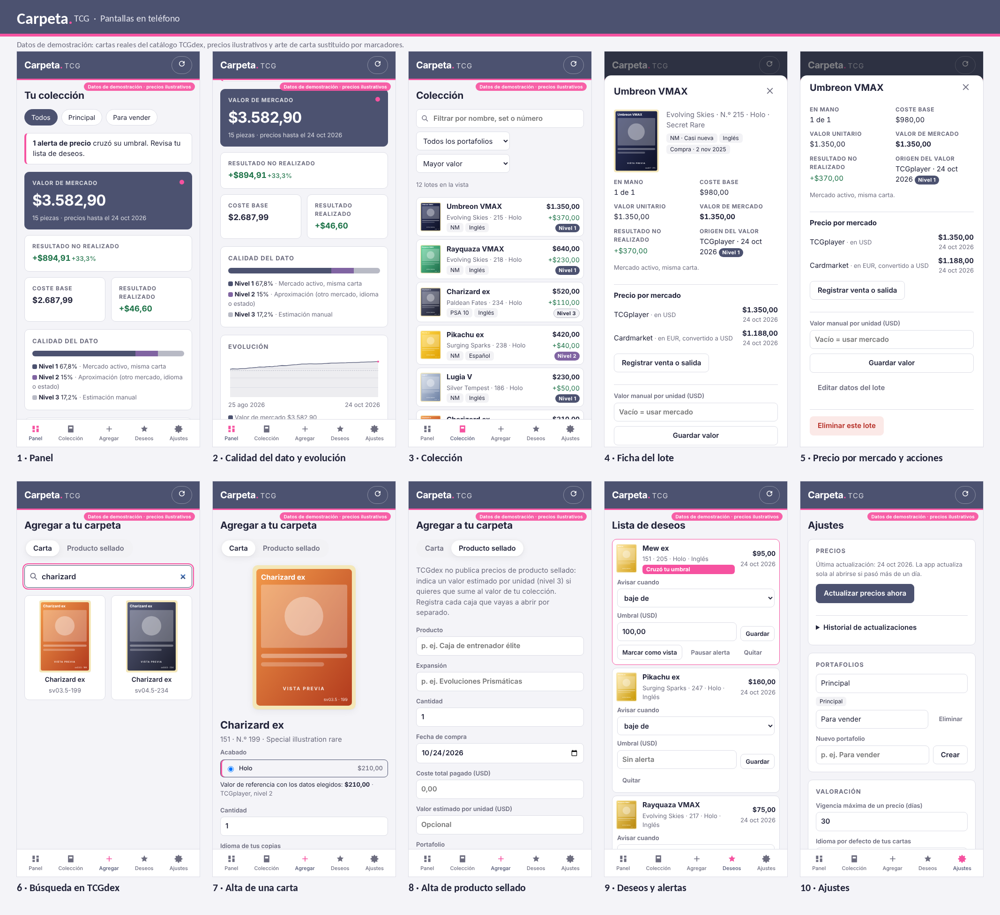
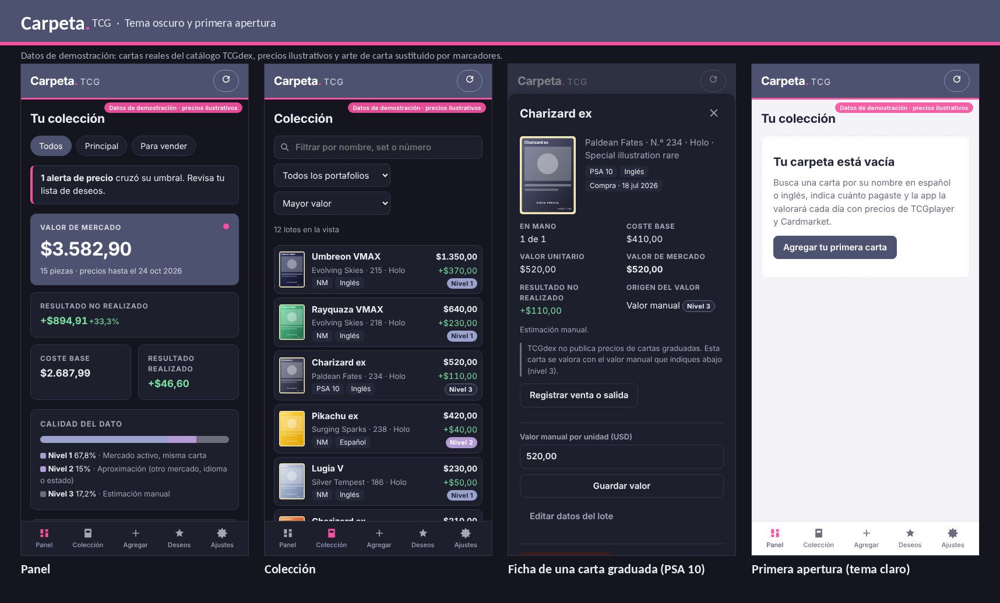

# Carpeta TCG

Aplicación web instalable (PWA) para registrar y valorar una colección de cartas Pokémon TCG. Funciona en el teléfono y en el computador, guarda los datos en el propio dispositivo y no requiere servidor ni cuentas.

## Pantallas

Capturas con datos de demostración: cartas reales del catálogo de TCGdex, precios ilustrativos y arte de carta sustituido por marcadores.





Escritorio: [panel](docs/capturas/escritorio-01-panel.png) · [colección](docs/capturas/escritorio-02-coleccion.png). Para regenerarlas: `CAPTURAS_DIR=./capturas npx playwright test capturas`.

## Qué hace

- **Busca cartas** por nombre en español o inglés, o por su código (`swsh7-215`), en el catálogo abierto de TCGdex.
- **Registra lotes:** cantidad, acabado (normal, holo, reverse holo, 1.ª edición), estado, idioma, graduación (PSA, BGS, CGC, SGC), fecha, canal y coste total pagado.
- **Valora a diario** con precios de TCGplayer (USD) y Cardmarket (EUR convertido con el tipo de referencia del BCE). Cada valor muestra su fuente, fecha y **nivel de valoración 1/2/3**.
- **Coste por identificación específica** y **resultado realizado** al vender, intercambiar, regalar o perder cartas.
- **Producto sellado:** al abrirlo, su coste se reparte entre las cartas obtenidas según su valor de mercado relativo, cuadrando al centavo.
- **Panel:** valor de mercado, coste base, resultados, calidad del dato por nivel, evolución diaria y cartas más valiosas.
- **Varios portafolios**, lista de deseos con **alertas de precio**, exportación a **CSV** (Excel en español) y **respaldo/restauración** en JSON.

La lógica de valoración es un port del modelo SQL de `../db/schema.sql` y se verifica con los mismos casos (T1–T10).

## Fuentes de datos

| Dato | Fuente | Acceso |
|---|---|---|
| Catálogo y nombres en español | TCGdex — `https://api.tcgdex.net/v2` | Gratuito, sin clave |
| Precios TCGplayer y Cardmarket | Campo `pricing` de la ficha de cada carta en TCGdex | Gratuito, sin clave |
| Tipo de cambio EUR→USD | BCE vía Frankfurter — `https://api.frankfurter.dev` | Gratuito, sin clave |

La forma del campo `pricing` no está declarada en el SDK oficial de TCGdex; se tomó de las mediciones documentadas en el paquete npm `@leewinder/mcp-tcgdex` 1.0.0. Si TCGdex cambia ese formato, la app deja las cartas sin precio (visible en el panel) en lugar de valorarlas mal.

## Usarla en tu computador

Requisitos: Node.js 22 o superior.

```bash
npm ci
npm run dev        # http://localhost:5173
```

## Publicarla para usarla en el teléfono

```bash
npm ci
npm run build      # genera la carpeta dist/
```

Sube la carpeta `dist/` a cualquier hosting estático con HTTPS (por ejemplo Netlify, Vercel, Cloudflare Pages o GitHub Pages; revisa las condiciones vigentes de cada servicio). La build usa rutas relativas, así que funciona también en una subcarpeta. En el teléfono, abre la dirección y elige **Agregar a pantalla de inicio**.

## Tus datos

Se guardan solo en el navegador del dispositivo (IndexedDB) y la app pide al navegador que no los borre. Cada dispositivo tiene su propia copia: para pasar la colección a otro equipo, usa **Ajustes → Descargar respaldo** y luego **Restaurar respaldo** en el otro. Haz respaldos con frecuencia.

## Desarrollo

```bash
npm run typecheck
npm test           # pruebas unitarias (motor, adaptadores, base local, respaldo y CSV)
npm run e2e        # recorrido completo en Chromium con APIs simuladas
```

Las pruebas usan catálogo real (`src/sources/fixtures/cards.json`, extraído de `@tcgdata/tcgdex-offline`) y **precios sintéticos**; ninguna cifra de las pruebas es un precio de mercado. `.npmrc` activa `legacy-peer-deps` para evitar un fallo de npm 10 al resolver dependencias opcionales de Vitest 4.

| Carpeta | Contenido |
|---|---|
| `src/domain` | Tipos y motor de valoración (cascada de precios, posiciones, resultados, coste conjunto, alertas) |
| `src/data` | Base local (Dexie), repositorio con validaciones, actualización de precios, respaldo y CSV |
| `src/sources` | Adaptadores de TCGdex y del tipo de cambio |
| `src/ui` | Interfaz React |
| `e2e` | Prueba de punta a punta con Playwright |

Pokémon y sus nombres son marcas de sus titulares. Esta app es de uso personal y no está afiliada a The Pokémon Company, a TCGplayer, a Cardmarket ni a Collectr.
